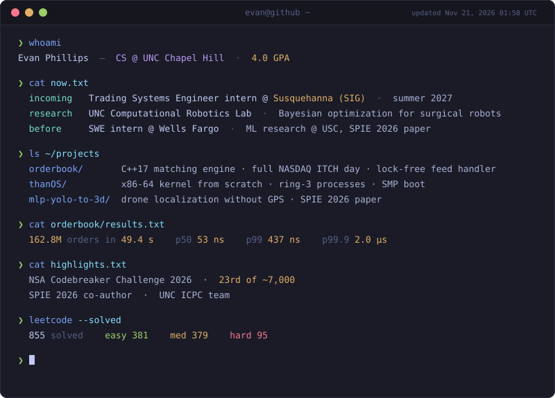

  

### What I've been building

- [**orderbook**](https://github.com/evanap003300/orderbook): a C++17 limit order book and matching engine. It replays a full NASDAQ ITCH day at a median of 53 ns per order.
- [**thanOS**](https://github.com/evanap003300/thanOS): an x86-64 kernel from scratch in freestanding C++, with paging, syscalls, and ring-3 processes scheduled across every core.
- [**mlp-yolo-to-3d**](https://github.com/evanap003300/mlp-yolo-to-3d): locating a drone in 3D from two cameras where GPS does not reach. Part of an [SPIE 2026 paper](https://doi.org/10.1117/12.3089966).
- [**systems-studying**](https://github.com/evanap003300/systems-studying): lock-free queues, allocators and STL containers, rebuilt to see how they work.

CS at UNC Chapel Hill. Find me on [LinkedIn](https://linkedin.com/in/evan-phillips111).
